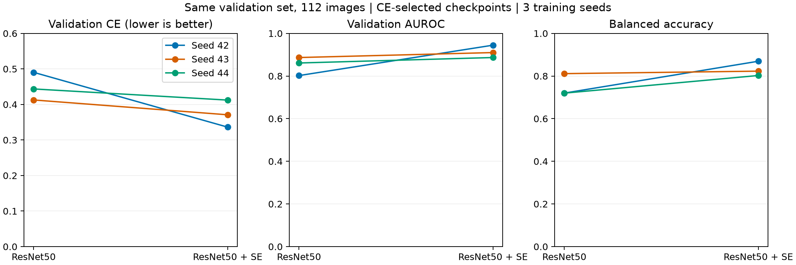
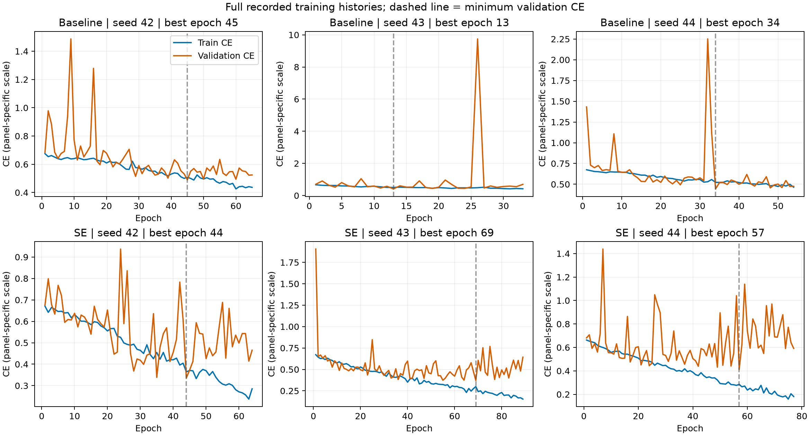

# ResNet50与SE三随机种子复验报告

记录时间：2026-10-30T21:48:44.921038+08:00

## 结论

四次新增复验均正常完成；结合已完成seed42，形成基线与SE各3次训练。三个种子中，SE的验证CE均低于基线，AUROC和平衡准确率均高于基线。支持将SE作为后续优化的优先候选，但尚不能证明独立数据上的泛化或临床有效性。

## 实验设置与来源

冻结v7整图二分类数据：训练893张（阴性候选332、阳性候选561），验证112张（43/69），测试112张。来源组计数为训练235、验证16、测试17；来源组未核验为独立患者。只使用train/val，本报告没有重新计算测试性能。
采用ResNet50预训练模型，基线与增加SE比较；640像素全视野等比缩放/补边、缓存v1、几何在线增强、CE、AdamW、lr0.001、weight_decay0.0001、batch4、workers0、FP32、最多100轮、patience20。每组从预训练初始化重新训练；seed43基线→SE，seed44 SE→基线。
按整体验证集无权重无平滑CE最低轮选择检查点；所有指标来自该轮，阳性类为1，阈值0.5。未改用AUROC最高轮。六组数据、缓存、增强、核心源码及记录的Python/PyTorch版本一致，具体指纹在results.json。
seed42来自20261029_141726正式汇总（基线实际复用20261029_114509）；seed43来自20261030_174612，seed44来自20261030_193451。

## 每次实验结果

| 种子 | 方案 | 完成/最佳轮 | 验证CE | AUROC | 平衡准确率 | 敏感度 | 特异度 | 准确率 |
|---|---|---|---:|---:|---:|---:|---:|---:|
| 42 | 基线 | 65/45 | 0.4904 | 0.8022 | 0.7199 | 0.6957 | 0.7442 | 0.7143 |
| 42 | SE | 64/44 | 0.3362 | 0.9447 | 0.8694 | 0.8551 | 0.8837 | 0.8661 |
| 43 | 基线 | 33/13 | 0.4127 | 0.8868 | 0.8113 | 0.8551 | 0.7674 | 0.8214 |
| 43 | SE | 89/69 | 0.3709 | 0.9100 | 0.8229 | 0.8551 | 0.7907 | 0.8304 |
| 44 | 基线 | 54/34 | 0.4437 | 0.8611 | 0.7198 | 0.8116 | 0.6279 | 0.7411 |
| 44 | SE | 77/57 | 0.4123 | 0.8868 | 0.8025 | 0.8841 | 0.7209 | 0.8214 |

## 三种子描述性汇总

以下为均值±样本标准差（n=3，ddof=1），标准差描述训练随机性，不是患者层面的置信区间。

| 指标 | 基线 | SE | SE减基线（均值） |
|---|---:|---:|---:|
| 验证CE | 0.4489 ± 0.0391 | 0.3731 ± 0.0381 | -0.0758 |
| AUROC | 0.8500 ± 0.0434 | 0.9138 ± 0.0292 | +0.0638 |
| 平衡准确率 | 0.7503 ± 0.0528 | 0.8316 ± 0.0343 | +0.0813 |
| 敏感度 | 0.7874 ± 0.0824 | 0.8647 ± 0.0167 | +0.0773 |
| 特异度 | 0.7132 ± 0.0748 | 0.7984 ± 0.0817 | +0.0853 |
| 准确率 | 0.7589 ± 0.0558 | 0.8393 ± 0.0236 | +0.0804 |

| 种子 | ΔCE | ΔAUROC | Δ平衡准确率 |
|---|---:|---:|---:|
| 42 | -0.1542 | +0.1426 | +0.1495 |
| 43 | -0.0417 | +0.0233 | +0.0116 |
| 44 | -0.0314 | +0.0256 | +0.0827 |

Δ为SE减基线。CE差为负表示改善；比率指标差乘100为百分点。seed42提升最大，43/44幅度较小，不能只引用seed42的最佳值代表稳定性能。

## 训练过程与混淆矩阵

六次训练均在最佳轮后20轮无改善而结束。图中保留完整记录，虚线为选择轮；各面板纵轴独立，不能直接比较视觉斜率。

训练诊断：seed43基线第26轮验证CE升至9.7464，seed44基线第32轮升至2.2515，均为实际历史值，图中未裁去。SE曲线后期也存在训练损失继续下降、验证损失波动/回升的现象。因此“所选检查点指标改善”不等于“全程训练已稳定”；应优先排查预测置信度、学习率及小批量归一化状态。仅凭曲线不能确定具体原因，后续诊断使用训练/验证数据。

| 种子 | 方案 | TN | FP | FN | TP |
|---|---|---:|---:|---:|---:|
| 42 | none | 32 | 11 | 21 | 48 |
| 42 | se | 38 | 5 | 10 | 59 |
| 43 | none | 33 | 10 | 10 | 59 |
| 43 | se | 34 | 9 | 10 | 59 |
| 44 | none | 27 | 16 | 13 | 56 |
| 44 | se | 31 | 12 | 8 | 61 |

## 解释边界与下一步

SE是从此前八组探索中筛选出的候选，三个种子仍共用同一112张验证集。重复训练不会增加独立图像或患者数，也不能消除验证集反复选模造成的乐观偏差。未做显著性检验、患者/来源组bootstrap置信区间、分部位/模态推理或校准分析；本报告只陈述已记录结果。
标签为正常/病变候选，未确认为临床诊断。已有测试集曾被历史评估，后续同集评估不能称全新独立盲测；最终研究确认需新的独立留出数据。
建议下一阶段以SE为优先候选，在固定其他条件下比较0.0001、0.0003和0.001学习率，预先固定预算与选模规则。AMP吞吐评估单独进行，兼顾数值稳定性，不同时更改输入大小/损失/注意力。本次未启动任何新训练，也未冻结最终交付检查点。

## 数据记录与复核范围

results.json含六次完整指标/逐轮历史/配置/环境/数据与源码指纹、配对差值、样本标准差和12个best/last权重SHA-256；evidence含训练元数据副本与来源汇总。inventory.json覆盖本记录文件，并进行了回读校验。
权重保留原实验目录，此处仅记录路径和哈希，不是含数据及权重的完整可迁移包。本次未反序列化权重或重新推理，哈希验证不等同模型加载验证。旧结果与原始数据保留。
复现报告：在项目根目录运行 `.venv/Scripts/python.exe -B scripts/record_repeat_results.py`，会生成新的独立记录目录。
